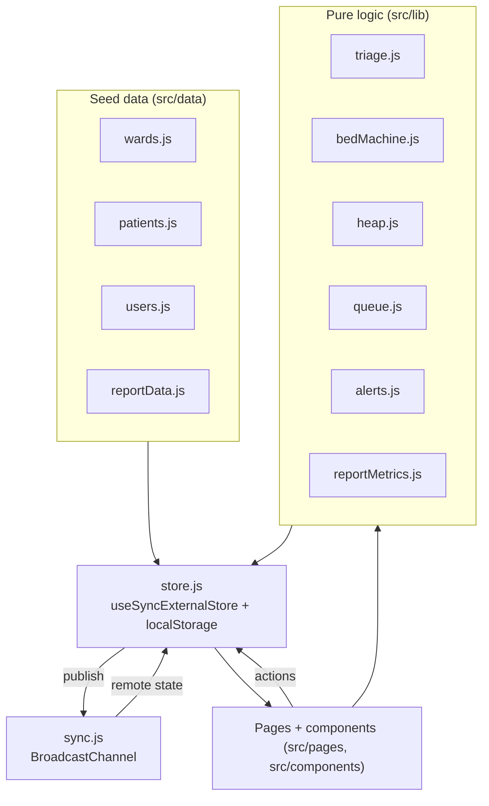
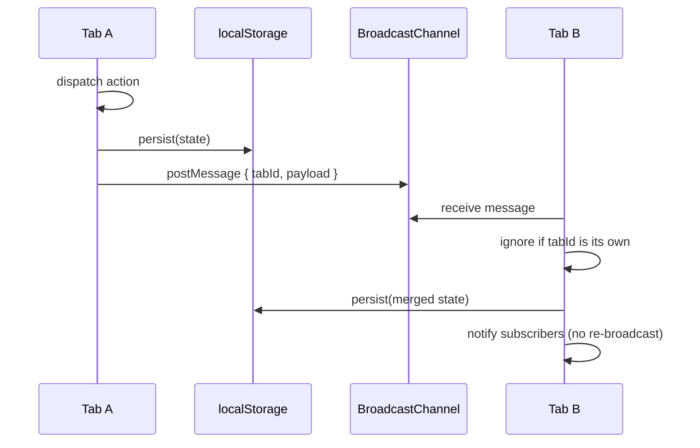
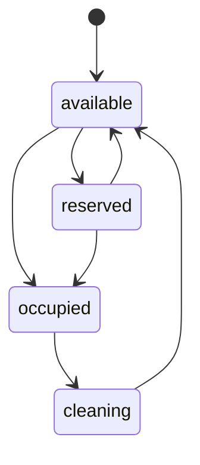

# Architecture

HealthSync is a frontend-only React application. There is no server: all of the
data is seeded in the browser, kept in a single in-memory store, persisted to
`localStorage`, and mirrored to other browser tabs over a `BroadcastChannel`.
The design goal is to keep the interesting logic (triage scoring, the priority
heap, the bed state machine, metric calculation, alert rules) as small pure
modules that are easy to unit test, and to keep React components as thin
rendering layers on top.

## Layers at a glance



- **`src/data`** holds the seed: wards and bed statuses, patients with vitals,
  the demo staff accounts and the historical analytics series.
- **`src/lib`** holds pure functions and two small infrastructure modules
  (`store.js`, `sync.js`). None of the pure modules import React or the DOM.
- **`src/pages` and `src/components`** render state and dispatch store actions.

## The store

`src/lib/store.js` is a hand-rolled store built on React's
`useSyncExternalStore` (no Redux, no context for app state). It exposes:

- `getState()` / `subscribe(listener)` - the external-store contract.
- `useStore()` - subscribe to the whole state object.
- `useStoreSelector(selector)` - subscribe to a derived slice, with the result
  cached and compared shallowly so returning a fresh object does not cause
  render loops.
- Action functions (`login`, `quickLogin`, `logout`, `setBedStatus`,
  `admitPatient`, `addPatient`, `reassessPatient`, `expireReservations`,
  `reset`, ...) that each return a small `{ ok, ... }` result the UI can toast.

State shape (see `hydrate()` and `createSeed()` in `src/lib/store.js`):

```js
{
  version: 2,               // SEED_VERSION - older seeds are discarded on load
  seededAt: <timestamp>,
  session: { userId, name, title, email, role, loginAt } | null,
  users: [...],
  wards: [...],
  beds: [...],              // status, patientId, occupiedSince, expiresAt, updatedAt
  patients: [...]           // vitals, score, level, breakdown, redFlag, history
}
```

Key storage keys:

| Key | Storage | Purpose |
| --- | --- | --- |
| `healthsync:state` | `localStorage` | Shared beds / patients / wards. The session is deliberately excluded. |
| `healthsync:session` | `sessionStorage` | The current tab's login, so two tabs can be signed in as different roles. |

`commit()` is the single write path: it swaps in the new state, persists it,
notifies subscribers, and (unless it is a remote update) broadcasts it. A
reservation-expiry sweep runs every 10 seconds and calls `expireReservations`,
moving any `reserved` bed whose `expiresAt` has passed back to `available`.

## Cross-tab synchronisation

`src/lib/sync.js` wraps a `BroadcastChannel` named `healthsync`. Each tab has a
random `tabId`; every message carries the sender's id and a tab ignores messages
it sent itself. The store also passes `{ broadcast: false }` when it applies a
remote update, which is what prevents A -> B -> A echo loops. The local session
is never included in broadcasts, so signing in or out in one tab does not affect
another.



## Bed state machine

`src/lib/bedMachine.js` is intentionally strict. Bed status is one of
`available`, `occupied`, `cleaning` or `reserved`, and only these transitions
are allowed (everything else is rejected and surfaced as a toast):



- `RESERVATION_MINUTES` is `30`; `setBedStatus` stamps `expiresAt` when a bed
  becomes `reserved` and clears it on every other transition.
- The expiry sweep returns stale reservations to `available`.
- `canTransition(from, to)` and `allowedNext(from)` are pure and drive which
  buttons the UI shows.

## Triage scoring

`src/lib/triage.js` implements a NEWS2-inspired score over six inputs. Each
input contributes 0-3 points:

| Vital | 3 | 2 | 1 | 0 |
| --- | --- | --- | --- | --- |
| Respiratory rate (/min) | <= 8 or >= 25 | 21-24 | 9-11 | 12-20 |
| SpO2 (%) | <= 91 | 92-93 | 94-95 | >= 96 |
| Systolic BP (mmHg) | <= 90 or >= 220 | 91-100 | 101-110 | 111-219 |
| Heart rate (/min) | <= 40 or >= 131 | 111-130 | 41-50 or 91-110 | 51-90 |
| Temperature (C) | <= 35.0 | >= 39.1 | 35.1-36.0 or 38.1-39.0 | 36.1-38.0 |
| Consciousness | any non-Alert | - | - | Alert |

The total maps to a level: `>= 7` is **critical**, `>= 5` is **urgent**,
otherwise **non-urgent**. A **red-flag** rule applies on top: any single vital
worth 3 points forces at least **urgent**. `validateVitals` and `validateAge`
provide per-field messages for the form.

## Priority queue and the heap

`src/lib/heap.js` is a generic `MaxHeap` written from scratch. Its comparator
returns a negative number when `a` should come out before `b`, and index 0
always holds the highest-priority item. Costs: `insert` and `extractMax` are
`O(log n)`, `peek` is `O(1)`, `remove(id)` and `updateKey` are `O(log n)`, and
`toSortedArray` is a non-destructive `O(n log n)` copy.

`src/lib/queue.js` scores each waiting patient with an aging rule:

```
effectivePriority = triageScore + 0.1 * minutesWaited
```

so a patient ages up the list the longer they wait. Ties break on earlier
arrival, then on id, so the order is deterministic. `buildQueue` computes
`effectivePriority` with a single `now` so every comparison in the heap uses the
same clock. `trendOf` compares the last two history entries to show whether a
patient is improving or deteriorating.

## Sessions and roles

`src/lib/roles.js` maps each role to a landing route and to its navbar links.
`ProtectedRoute` reads the current session and redirects anyone who is not
allowed on a page; `ForbiddenAlert` explains the bounce. The session lives in
`sessionStorage` (per tab) while the shared data lives in `localStorage`, which
is what lets a doctor tab and a nurse tab run side by side.

## Alerts

`src/lib/alerts.js` is pure: it exports the thresholds and predicate helpers
(critical waiting patients, ICU occupancy crossing 90% with re-arm below 85%,
beds left cleaning for more than 45 minutes, and which roles each alert targets).
The stateful "have I already fired this?" latches (seen patient ids, the ICU
occupancy latch, reminded beds) live in `src/components/AlertWatcher.jsx`, which
watches the store and pushes messages into the per-tab alert centre
(`src/lib/alertCenter.js`) behind the navbar bell.

## Analytics

`src/lib/reportMetrics.js` separates three kinds of number:

- **Live** measures computed from the current store (`currentOccupancy`,
  `occupancyByWard`, `waitingNow`, `liveAverageWait`).
- **Mock history** accessors reading `src/data/reportData.js`
  (wait-by-level, turnover-by-ward, average cleaning time, hourly occupancy).
- **Derived** display helpers such as `heatmapColor` (a clamped `hsl` ramp) and
  the `toCsv` / `reportCsv` exporters.

`buildInsights` turns the heatmap and live occupancy into two or three short
sentences. The admin page labels mock series clearly so the two are never
confused.

## Determinism and testing

Time-dependent logic takes an explicit `now` argument so tests never depend on
the clock, and the isolated test setup (`src/test/setup.js`) clears storage and
replaces `BroadcastChannel` with a no-op. See `docs/TESTING.md` for the full
breakdown of the 173 tests.

## Extending it

- **Add a bed status:** update `TRANSITIONS` in `src/lib/bedMachine.js` and the
  `STATUS_META` table in `src/lib/bedMeta.js` (label + colour). The dashboard
  and modal pick up the new state automatically.
- **Add a vital:** add a point rule and an entry to the `VITALS` array and the
  `VITAL_RANGES` map in `src/lib/triage.js`, then add a field to
  `src/components/VitalsFields.jsx`.
- **Add a metric:** add a pure function in `src/lib/reportMetrics.js` and a
  `StatCard` on the admin page. Keep history accessors in
  `src/data/reportData.js`.
- **Swap in a backend:** replace the seed/hydrate path in `src/lib/store.js`
  with fetches and keep the action signatures the same; the components do not
  need to change. `VITE_API_URL` is reserved in `.env.example` for this.
